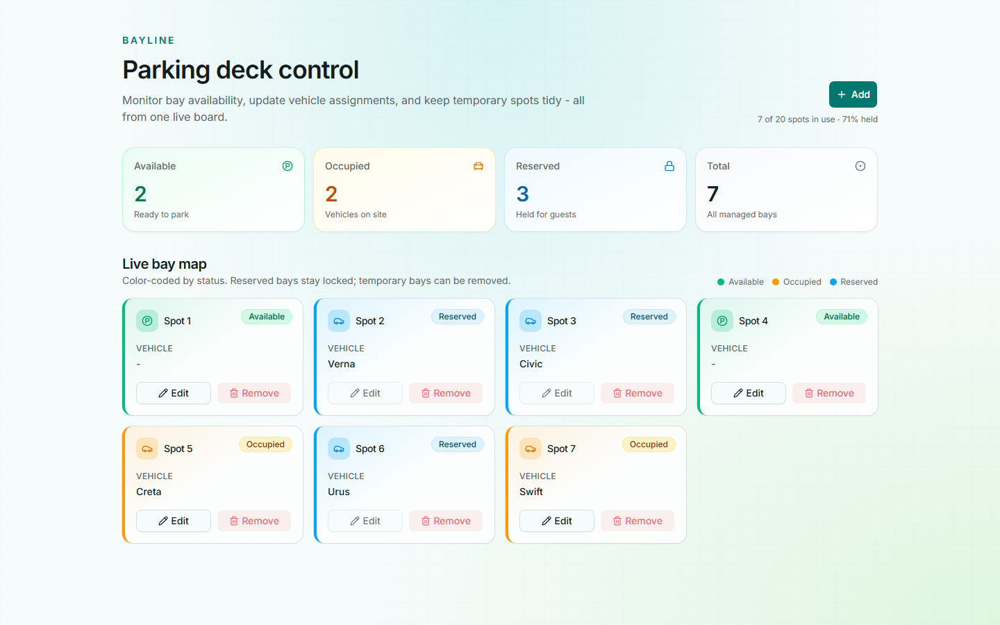
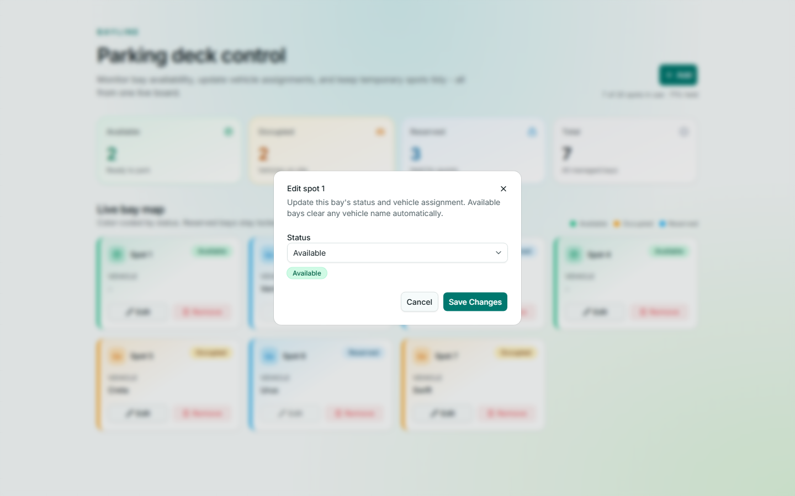
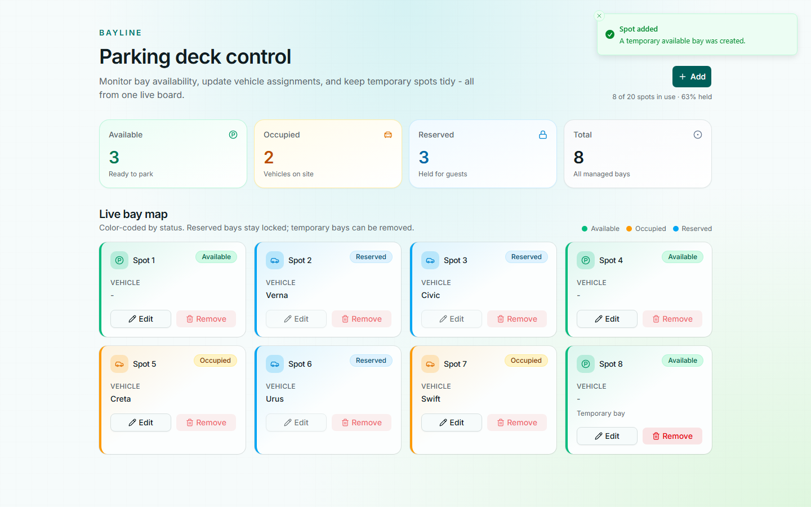
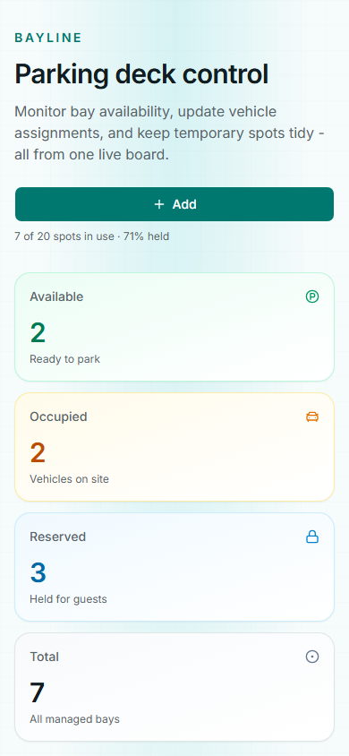

# Bayline - Parking Deck Control

A modern React parking management UI for monitoring bay availability, assigning vehicles, and managing temporary spots from a single live board.

**Live demo:** [https://moshahan.github.io/bayline/](https://moshahan.github.io/bayline/)



## Overview

**Bayline** helps attendants and operators see the parking deck at a glance:

- Track **available**, **occupied**, and **reserved** bays with color-coded cards
- Edit bay status and vehicle assignments in a focused modal
- Add temporary bays (up to a configurable max) and remove them when done
- Get clear toast feedback for success and blocked actions
- Unknown URLs always redirect back to the home page

Built with **React 19**, **Vite**, **Redux Toolkit**, **Tailwind CSS**, **shadcn/ui**, **Sonner**, and **React Router**.

## Features

| Feature | Description |
| --- | --- |
| Live bay map | Responsive grid of spot cards with status accents and badges |
| Stats overview | Available / Occupied / Reserved / Total counts at the top |
| Add spot | Creates a temporary available bay (max **20** spots) |
| Edit spot | Update status between Available and Occupied; vehicle required when occupied |
| Remove spot | Only temporary bays can be removed |
| Toast feedback | Success and error messages for add / edit / remove / capacity / locked actions |
| Route guard | Any unknown path (e.g. `/foo`) redirects to `/` |
| Responsive layout | Works on desktop and mobile viewports |

### Spot statuses

| Status | Meaning | Typical actions |
| --- | --- | --- |
| **Available** | Empty bay ready to park | Edit → Occupied (+ vehicle), or leave empty |
| **Occupied** | Vehicle is parked in the bay | Edit → Available (clears vehicle) |
| **Reserved** | Held / locked bay | Edit is blocked with an explanatory toast |

### Screenshots

**Desktop dashboard**


**Edit modal**



**Toast feedback (e.g. after adding a spot)**



**Mobile layout**



## Tech stack

- **UI:** React 19, Tailwind CSS 4, shadcn/ui (Base UI), Lucide icons
- **State:** Redux Toolkit + React Redux
- **Routing:** React Router (`/` + catch-all redirect)
- **Feedback:** Sonner toasts
- **Tooling:** Vite 8, TypeScript, ESLint, Vitest + Testing Library
- **Compiler:** React Compiler (via Babel preset)

## Prerequisites

- [Node.js](https://nodejs.org/) **18+** (recommended: current LTS)
- npm (comes with Node)

## Installation

```bash
# Clone the repository
git clone https://github.com/MoShahan/bayline.git
cd bayline

# Install dependencies
npm install
```

## Running the app

### Development

```bash
npm run dev
```

Open the URL Vite prints (usually `http://localhost:5173`).

### Production build

```bash
npm run build
npm run preview
```

`build` type-checks and outputs to `dist/`. `preview` serves that build locally.

## Available scripts

| Command | Description |
| --- | --- |
| `npm run dev` | Start Vite dev server with HMR |
| `npm run build` | Type-check (`tsc -b`) and production build |
| `npm run preview` | Preview the production build |
| `npm run lint` | Run ESLint |
| `npm run lint:fix` | Run ESLint with auto-fix |
| `npm test` | Run Vitest once |
| `npm run test:watch` | Run Vitest in watch mode |
| `npm run test:coverage` | Run Vitest with coverage |

## Project structure

```text
bayline/
├── .github/workflows/      # Lint, test, and GitHub Pages deploy
├── components/ui/          # shadcn UI primitives (button, card, dialog, …)
├── docs/screenshots/       # README screenshots
├── lib/                    # Shared utilities (e.g. cn)
├── src/
│   ├── app/                # Redux store + typed hooks
│   ├── features/parking/   # Slice + selectors (+ tests)
│   ├── App.tsx             # Main dashboard
│   ├── AppRouter.tsx       # Routes + unknown-path redirect
│   ├── SpotCard.tsx        # Individual bay card
│   ├── EditModal.tsx       # Edit dialog
│   ├── statusStyles.ts     # Status colors / labels
│   ├── constants.ts        # MAX_SPOTS, editable statuses
│   ├── data.json           # Seed parking data
│   └── main.tsx            # App bootstrap
├── index.html
├── package.json
└── vite.config.ts
```

## How it works (quick)

1. Seed data loads from `src/data.json` into the Redux parking slice.
2. The dashboard reads spots/stats via selectors and renders the bay map.
3. **Add** dispatches `addSpot` (or shows a capacity error toast at 20 spots).
4. **Edit** opens a single controlled dialog; save validates occupied + vehicle, then `updateSpot`.
5. **Remove** only succeeds for `temporary` spots; otherwise a toast explains why.
6. Reserved spots stay locked for editing; clicking Edit shows a toast instead of a disabled button.
7. `AppRouter` maps `/` to the app and `*` → redirect home.

## Configuration

- **Max spots:** `MAX_SPOTS` in [`src/constants.ts`](src/constants.ts) (default `20`)
- **Seed data:** [`src/data.json`](src/data.json)
- **Theme tokens:** [`src/index.css`](src/index.css)

## Testing

```bash
npm test
```

Coverage includes the parking slice/selectors, SpotCard, EditModal, App flows, and router redirects.

## Deployment

The demo is published to **GitHub Pages** at [https://moshahan.github.io/bayline/](https://moshahan.github.io/bayline/).

Pushes to `main` (and manual runs from the Actions tab) trigger [`.github/workflows/deploy.yml`](.github/workflows/deploy.yml). That workflow:

1. Installs dependencies with `npm ci`
2. Builds with `GITHUB_PAGES=true` so Vite uses the `/bayline/` base path
3. Copies `dist/index.html` to `dist/404.html` so unknown paths still load the SPA (and redirect home)
4. Uploads `dist/` and deploys it with the official GitHub Pages actions

### First-time GitHub Pages setup

In the repository: **Settings → Pages → Build and deployment → Source → GitHub Actions**.

After the first successful deploy, the site is available at `https://moshahan.github.io/bayline/`.

## License

Private project (`"private": true` in `package.json`).
